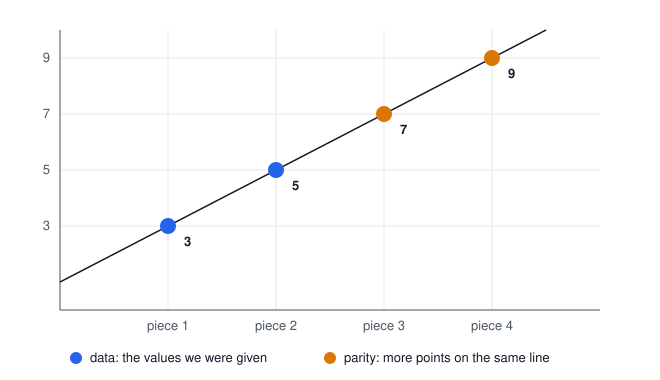
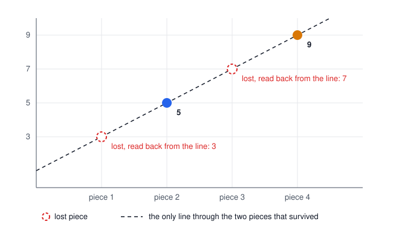
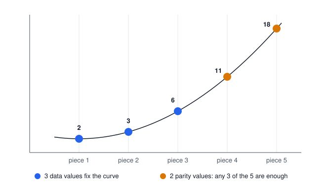
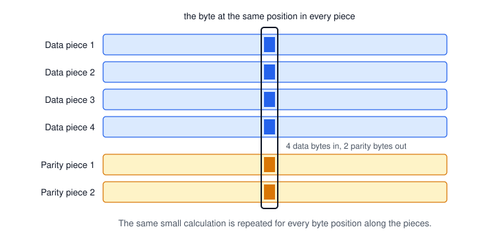
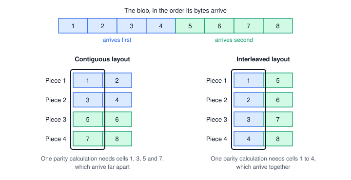
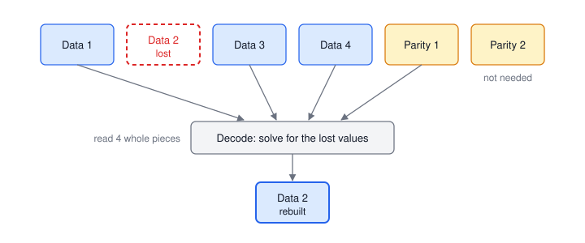
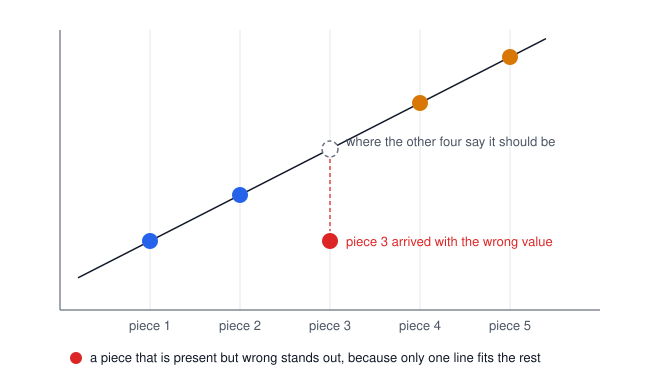

# How Reed-Solomon works

Reed-Solomon turns k pieces of data into n pieces, where any k of the n are enough to get the data back. It does this by treating the data as points on a curve and storing extra points from the same curve. The rest of this page builds that idea up from two numbers to a whole blob.

## Two numbers and a line

Take two numbers we want to protect, 3 and 5. Plot them as the first two points of a graph and draw the line through them. Then read two more values off the line, 7 and 9, and store all four.



Two points are enough to draw a line, and it does not matter which two. So any two of the four stored values are enough to redraw the line and read the others back from it.



Here pieces 1 and 3 are lost. Pieces 2 and 4 hold 5 and 9. The line through them rises by 2 for each step, so piece 1 was 3 and piece 3 was 7.

We stored four values to protect two, and can lose any two of them. Two full copies of the data would also store four values, but would lose data if both copies of the same number went missing.

## More data, a curve with more bends

A line is fixed by two points. A curve with one bend (a parabola) is fixed by three, a curve with two bends by four, and so on. Mathematicians call these curves polynomials. The rule is that k points fix exactly one polynomial of this kind.

So to protect k values, find the curve through them and store n points from it. Any k of the n recover the curve, and with it every other point.



Here k is 3 and n is 5. The data values 2, 3 and 6 fix the curve, which then passes through 11 and 18. Any three of the five values give the curve back.

Two properties follow from the picture:

- **Any k will do.** No piece is special. Losing any n − k pieces is survivable, and losing one more is not. No code can do better for the same amount of storage.
- **The data pieces are the data.** The first k points are the original values, unchanged. Reading healthy data needs no calculation at all. A code with this property is called systematic.

## Arithmetic that stays inside a byte

The curve example has a problem for a computer. The data values were at most 6, but a parity value came out as 18. With real data the parity values grow without limit, and working backwards involves division, which produces fractions.

Reed-Solomon avoids both by using a different arithmetic, called a finite field. The usual choice has exactly 256 values, one for each possible byte, and is written GF(2^8). It has its own rules for adding and multiplying:

- Adding two bytes is XOR.
- Multiplying two bytes is a lookup in a precomputed table.
- Every result is again a single byte, so nothing grows.
- Every value except zero can be divided by exactly, so nothing turns into a fraction.

The lines and curves no longer look like anything on a graph, but the rule that matters still holds: k points fix exactly one curve. Everything above carries over, and each parity value is one byte.

A field with 256 values has 256 different positions to put points at, so this arithmetic supports at most 256 pieces. Libraries that go beyond that use a field with 65,536 values.

## From numbers to a blob

To code a whole blob, split it into k data pieces of equal size. Then take the first byte of each piece. Those k bytes are k values, so compute the parity bytes for them and write each into the first byte of a parity piece. Do the same for the second byte of each piece, and the third, to the end.



This is why every piece is the same size, and why the parity pieces are as large as the data pieces. With 4 data pieces and 2 parity pieces, the blob is stored at 6 / 4 = 1.5 times its size and survives the loss of any 2 pieces.

Each byte position is independent, so the work splits across CPU cores and suits vector instructions. Good libraries encode more than a gigabyte per second on one core.

## What the encoder computes

Nobody draws curves in practice. Each parity value is a fixed weighted sum of the data values, and the weights are worked out once from the positions of the points.

For the line example, with ordinary numbers:

```
piece 1 =  1 × d1 + 0 × d2        the data, unchanged
piece 2 =  0 × d1 + 1 × d2        the data, unchanged
piece 3 = -1 × d1 + 2 × d2        parity
piece 4 = -2 × d1 + 3 × d2        parity
```

With d1 = 3 and d2 = 5 this gives 3, 5, 7 and 9, the same values as the graph.

That table of weights is the encoding matrix. Decoding uses the same table. Keep the rows for the pieces that survived, and you have k equations in k unknowns. With pieces 2 and 4:

```
5 =  0 × d1 + 1 × d2
9 = -2 × d1 + 3 × d2
```

The first line gives d2 = 5. The second then gives d1 = 3. A decoder does this by inverting a small matrix once, then applying the result to every byte position.

## Streaming

An encoder does not have to hold the whole blob in memory. Each byte position is coded on its own, so the encoder needs only the bytes for the positions it is working on. How much that is depends on how the blob is laid out across the pieces.



There are three ways to encode a stream:

- **Contiguous layout, buffered.** Piece 1 is the first part of the blob, piece 2 the next, and so on. One parity byte needs the same position from every data piece, and those bytes arrive far apart in the stream. A plain encoder holds the whole blob, or spools it to disk and reads k positions at once.
- **Interleaved layout**, often called striped. Read the stream one row of k cells at a time, compute the parity cells for that row, and append each cell to its piece. Memory is one row, and pieces can be sent to storage as they grow. The blob's length does not need to be known in advance, and the last row is padded. Storj uses 256-byte cells and HDFS uses 1 MiB cells.
- **Contiguous layout, parity built up as data arrives.** A parity piece is a weighted sum of the data pieces, so it can be added to one data piece at a time. Data pieces pass straight through to storage and only the parity pieces are held in memory. The blob's size has to be known first, to know where each piece starts. `klauspost/reedsolomon` calls this progressive encoding.

| Approach | Memory held while encoding | Blob size known in advance |
| --- | --- | --- |
| Contiguous, buffered | The whole blob, plus parity | Yes |
| Interleaved | One row of k + m cells | No |
| Contiguous, parity built up | The m parity pieces | Yes |

The layouts read differently. In a contiguous layout a byte range of the blob usually sits in one piece, so a range read fetches from one place. In an interleaved layout the blob is dealt out across all k data pieces, a cell at a time. A read that fits inside one cell still fetches from one place, but anything longer fetches from several pieces at once and puts the cells back in order, and a full read draws on all k for its whole length. Larger cells reduce the interleaving and raise the memory held.

The layout fixes the bytes of every piece, so it is part of what must stay the same for a stripe to remain decodable. A stripe written in one layout cannot be repaired or read as the other.

## Repair

Rebuilding a lost piece is decoding. Read any k surviving pieces, solve for the missing values, and write the piece back.



This is Reed-Solomon's main cost. Losing one piece means reading k whole pieces to replace it. With 4 data pieces, repairing 1 GiB reads 4 GiB. Inside a data center that is cheap. Between data centers it is the reason other codes exist.

## Missing pieces and wrong pieces

Everything so far assumes we know which pieces are missing. That case is called an erasure, and it is the easy one.

A piece can also be present but wrong, from a failing disk or a dishonest storage node. The picture still helps. A wrong value does not sit on the curve that the other pieces agree on.



There are two ways to deal with wrong pieces:

- **Keep a digest of every piece.** Check each piece against its digest before decoding and throw away any that fail. A wrong piece becomes a missing one, and the simple decoder is enough. Most storage systems do this.
- **Let the decoder find them.** Given more than k pieces, an error-correcting decoder searches for the curve that most pieces agree on and discards the rest. Each wrong piece costs two spare pieces to correct, where a missing one costs one. In the picture there are five pieces and two are needed, so one wrong piece can be found and fixed. The `infectious` library works this way.

## Summary

| Property | Reed-Solomon with k data pieces and n pieces in total |
| --- | --- |
| Storage used | n / k times the data |
| Pieces that can be lost | Any n − k |
| Healthy read | Reads the k data pieces, no calculation |
| Read with pieces missing | Reads any k pieces and decodes |
| Repair of one piece | Reads k pieces |
| Wrong pieces | Caught by a digest per piece, or by an error-correcting decoder at two spare pieces each |
| Limit on n | 256 with byte arithmetic, 65,536 with 16-bit arithmetic |

For how Reed-Solomon compares with other codes, see the [survey](./erasure-coding-survey.md).
