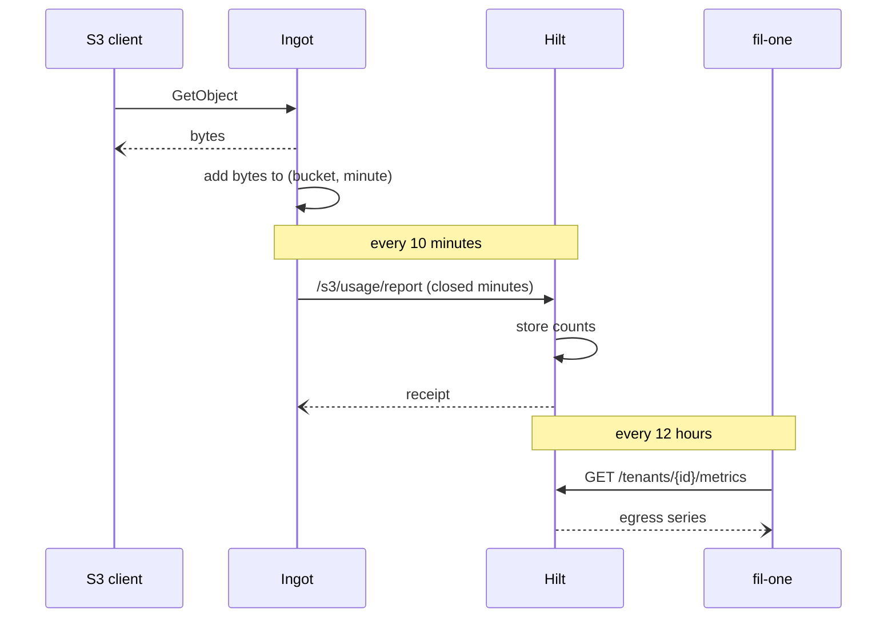

# RFC: Egress counters for Ingot

Status: Experimental

## Authors

- [Alan Shaw](https://github.com/alanshaw)

## Motivation

Trial accounts are to be disabled once they pass the trial egress limit (2 TB in fil-one today), and nothing records egress on a Forge network. fil-one's usage job already sums an egress series it asks Hilt for, and Hilt already returns one for a tenant and for a bucket. The series is always empty, because nothing feeds it.

This RFC proposes that Ingot counts the bytes of object data it sends to S3 clients, per bucket and per minute, and pushes the counts to Hilt, which serves them in the series it already has.

It is an alternative to [Egress tracking for Ingot](https://github.com/fil-one/RFC/pull/41), which records a signed receipt for every read and reports them through the egress tracking service. The two are compared under [Alternatives considered](#signed-receipts-through-the-egress-tracking-service).

## Goals

- Hilt's egress series for a bucket and for a tenant reports what Ingot sent, within minutes.
- A count does not depend on which tier served a read, on encryption, or on the egress tracking service being deployed.
- Counting adds no network call, no signature and no database write to a GET.
- A report that fails or is sent twice changes no total.

## What is counted

Egress is the bytes of object data in the bodies of GetObject responses. Ingot counts them where it hands an object's body to the response, as the response reads them.

- **Encryption does not change the count.** The body is counted after decryption and after trimming to the requested range, so a 4 KiB ranged GET counts 4 KiB whatever was read from disk or from a storage node to produce it.
- **The cache does not change the count.** A cache hit and a cache miss send the same bytes.
- **An abandoned GET counts what was sent** before the client went away.
- **Server-side reads are not counted.** A copy reads its source through a different path, and catalog blocks are never part of a response body.
- **Response headers and TLS overhead are not counted.** AWS S3 ignores `Accept-Encoding`, so a body is sent as it was stored and no compression needs accounting for.

## Design



### Counting in Ingot

Ingot keeps a running count in memory for each bucket's space and the current minute, in UTC. Every 5 seconds it adds the counts to a table in its Postgres schema and clears them:

| Column | Meaning |
| --- | --- |
| `space` | the bucket's space |
| `minute` | start of the minute, UTC |
| `bytes_sent` | bytes sent in that minute |
| `bytes_reported` | the value of `bytes_sent` Hilt last acknowledged |

The write adds to the row for (space, minute), so several Ingot instances sharing a database count into the same rows. A crash loses at most 5 seconds of counts. Egress is under-counted after a crash and never counted twice.

A bucket with no reads in a minute has no row for it.

### Reporting to Hilt

A new command, `/s3/usage/report`, carries counts from Ingot to Hilt. The counts are Ingot's own account of what it sent, so Ingot is the subject of the invocation as well as its issuer, and Hilt is the audience. An invocation on the issuer's own authority needs no delegation.

```jsonc
{
  "iss": "did:web:ingot.example.com",
  "aud": "did:web:hilt.example.com",
  "sub": "did:web:ingot.example.com",
  "cmd": "/s3/usage/report",
  "args": {
    // one entry for each space
    "egress": [
      [
        "did:key:zBucketSpaceA",
        [
          // [start of minute (Unix seconds), bytes sent]
          [1795600800, 5368709120],
          [1795600860, 1048576]
        ]
      ],
      [
        "did:key:zBucketSpaceB",
        [
          [1795600800, 4096]
        ]
      ]
    ]
  }
}
```

A task on Ingot's task runner runs every 10 minutes, which is configurable. It sends the rows whose minute ended more than a minute ago and whose `bytes_sent` differs from `bytes_reported`, up to 1,000 minutes in one invocation, and sets `bytes_reported` when Hilt answers. A count that reaches a row late is therefore sent again, with the row's new total.

When more than 1,000 minutes are waiting, after many buckets were read or Hilt was unreachable, the task sends further invocations, oldest minutes first, until none are left. Each invocation is acknowledged on its own, and one space's minutes may be split across several, since Hilt stores each minute separately.

The command is named for usage, with egress as one field of its arguments, so that it can carry other counts only the gateway knows. Object counts are the expected next one: Ingot registers every object with the upload service today only so that it can be counted there.

The entries are tuples, grouped by space, so a space's DID is sent once however many minutes it has. A report names no tenant. Hilt knows each bucket's tenant and provider, and looks them up by space.

Hilt accepts a report only from an issuer it has registered as a provider. It stores one row for each (provider, space, minute), where the provider is that issuer, with the bucket's tenant beside it. A report replaces the row's count, so one that is repeated, or resent after a lost response, leaves the same totals. Hilt refuses counts for a space it does not know and for a bucket that another provider serves.

Hilt deletes a bucket's record when the bucket is deleted, and a report for the bucket's last minutes can arrive afterwards. Hilt therefore keeps the space, tenant and provider of a deleted bucket for 7 days, and attributes and checks late counts against that.

Ingot sends nothing when it has no rows to report.

Ingot deletes a row 7 days after it was last reported. Until then a report can be repeated if Hilt loses data.

### Serving from Hilt

Hilt's metrics endpoints already return an egress series beside storage and ingress, for a tenant and for a bucket, in windows of whole hours. Hilt fills each sample with the sum of the minutes that start in its window: a bucket's from the rows for its space, a tenant's from the rows stored with that tenant, which include its deleted buckets'. A window with no rows reports zero. Counts that arrive later, up to the reporting interval behind or longer after an outage, raise the windows they belong to.

fil-one needs no change to read it. Its usage job asks for each tenant's series from the start of the current billing period to now, sums it and applies the limit, so a tenant's egress is already totalled across its buckets. The limit is on egress within a billing period.

### How late a count is

A byte sent is in Ingot's database within 5 seconds, in a closed minute within 2 minutes, and at Hilt within about 12 minutes at the default interval. fil-one's usage job runs every 12 hours, and that interval decides how far past the limit a trial account can read.

The job sums the whole period again on every run and keeps no running total. A count that reaches Hilt late, after an outage, is missing from one run and included in the next, so a late report delays the limit by at most one run and loses no egress.

### Trust

Hilt takes Ingot's counts on Ingot's word. Ingot already authenticates every request, enforces every bucket policy and decrypts every object, so the counts add little to what is already trusted of it. Appliance operators are not paid for egress, so an operator gains nothing from a wrong count.

Storage nodes are a different case and this RFC does not change it. A node's egress is evidenced by the `/content/retrieve` receipts it issues for invocations its clients sign, reported through the egress tracking service.

## Operations

- **Storage.** The counts live in Ingot's Postgres schema with the rest of its state, and are backed up and restored with it. A bucket read in every minute of a week holds about 10,000 rows. No new filesystem or quota is needed.
- **Metrics.** Ingot reports the number of rows waiting to be reported and the age of the oldest.
- **Alerts.** An Ingot whose oldest waiting row is older than three intervals. This catches reports that are failing. Detecting an Ingot that is down is left to the monitoring that already watches the appliance.
- **Delegations.** None are added or changed, for an appliance or for an access key. Removing a provider from Hilt stops its reports being accepted.

## Alternatives considered

### Signed receipts through the egress tracking service

[Egress tracking for Ingot](https://github.com/fil-one/RFC/pull/41) has Ingot invoke a new `/content/serve` command on itself for each blob it serves, sign the receipt, journal both, and report batches to the egress tracking service, which totals them. It gives one mechanism for Ingot and for storage nodes, a signed record of every read that can be totalled again after a counting bug, and one place to total several Ingots.

The receipts do not make Ingot's figures independent of Ingot. Ingot issues the invocation and signs the receipt, and an Ingot that under-reported would write no record. S3 authentication is symmetric, so whoever can verify a client's request can also forge one, and a gateway cannot hold evidence that only its client could have produced.

The cost of that design falls on the trial limit. It waits for the egress tracking service to move to UCAN 1.0 and be deployed, and it needs a new grant on every access key, a journal with its own storage and quota, a batch endpoint on the S3 listener and two signatures for each blob read.

### Hilt pulls from each Ingot

Hilt could ask each Ingot for its counts on a schedule. Hilt would control the load, and a failed request would be an immediate sign of trouble. It needs Hilt to know and reach every Ingot, and a UCAN endpoint on Ingot's S3 listener, which serves only S3 today. Counts not yet collected would be stuck on an appliance that is offline or being retired.

### An access log

Ingot could write a line for each GET and ship the log, and totals would be computed centrally. Every read would be itemised and totals could be recomputed. The log is far larger than the counts, needs its own shipping and retention, and the trial limit needs none of the detail.

## Open questions

1. **Minutes.** Hilt serves windows of whole hours. Minutes cost more rows than hours and let the windows start on any minute. Is an hour enough?

## Evaluation criteria

- A GET of a known number of bytes adds that number to the bucket's and the tenant's egress at Hilt.
- A ranged GET of an encrypted object adds the length of the range.
- A GET abandoned part way adds what was sent, and a CopyObject adds nothing.
- The same requests add the same egress with Ingot's cache enabled and with `cache_writes: false`.
- Hilt accepts a report that carries no proofs from a registered provider, and refuses one from any other issuer.
- With Hilt unreachable for an hour and then restored, Hilt's totals equal Ingot's, with nothing counted twice.
- These run against the smelt stack in CI.

## Order of work

1. Add `/s3/usage/report` to libforge.
2. Hilt: store the counts, keep a deleted bucket's tenant and provider for 7 days, and fill the egress series.
3. Ingot: count, store and report, with the metrics above.

## References

- [Egress tracking for Ingot](https://github.com/fil-one/RFC/pull/41)
- [Hilt](https://github.com/fil-forge/hilt)
- [Ingot](https://github.com/fil-forge/ingot)
