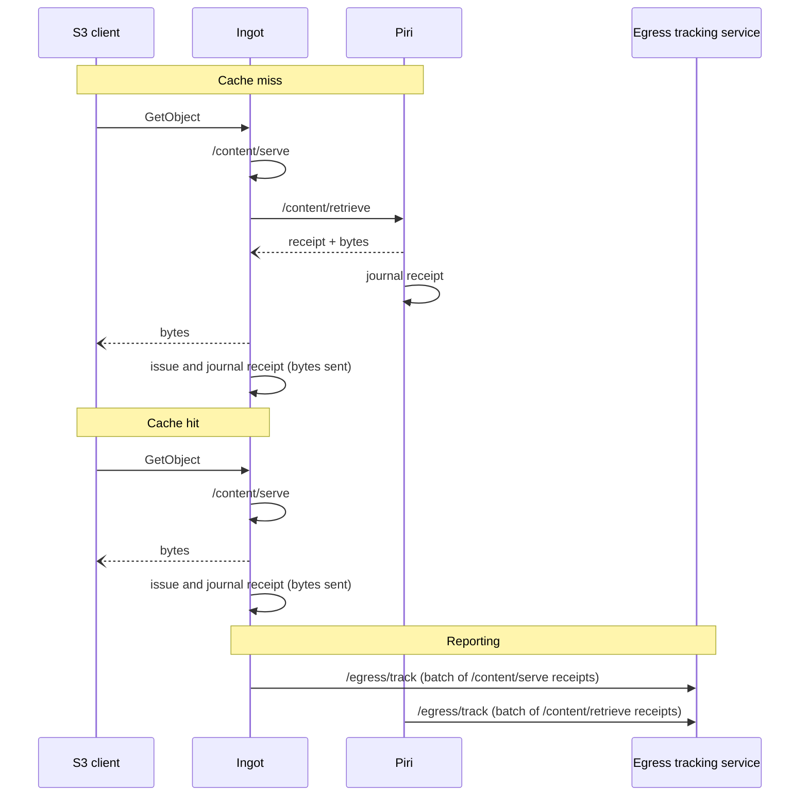

# RFC: Egress tracking for Ingot

Status: Experimental

## Authors

- [Alan Shaw](https://github.com/alanshaw)

## Motivation

Trial accounts are to be disabled once they have read more than 1 TiB, and nothing records egress on a Forge network today. Piri's egress tracker has been off since the UCAN 1.0 migration ([piri#14](https://github.com/fil-forge/piri/issues/14)) and the egress tracking service is not deployed. Bringing both back records what storage nodes serve, which is a different quantity from what customers read.

Ingot serves a blob from its local cache when it holds a copy and from the storage node otherwise. Only a read from the node reaches Piri as a `/content/retrieve` invocation and produces a receipt. The cache keeps every blob written by a PutObject for an hour after its last write or read, so a bucket read soon after it is written would report almost no egress. Once Ingot also fills the cache on reads, repeat reads of a popular object go unrecorded too.

What Piri records is also more than the customer read. A cache fill may fetch a whole blob to answer a ranged GET, a copy between spaces reads its source from the node, and Ingot fetches its own catalog blocks. Piri cannot tell any of these from a customer's read.

This RFC proposes that Ingot records every blob range it serves to an S3 client, whichever tier the bytes came from, and reports the records to the egress tracking service as a storage node reports retrievals. Customer egress is read from Ingot's records alone. The journal, batching and reporting code becomes a libforge package shared with Piri.

## Goals

- A space's customer egress comes from one reporter and does not depend on which tier served a read, or on whether Piri's reporting is running.
- Reads that never leave for the customer (cache fills, server-side copies, catalog blocks) are absent from customer egress.
- The tracker receives Ingot's records and Piri's in the same batch format, through the same command.
- Piri and Ingot share one implementation of the journal, the batching and the reporting.
- Recording a read adds no network call and no database write to a GET.

Moving the egress tracking service to UCAN 1.0 and deploying it from `infra-central` is separate work that this design depends on. Re-enabling Piri's tracker can follow later, because the trial limit needs only Ingot's records. Both are listed under [Order of work](#order-of-work).

## Design



### Two totals

The tracker keeps two totals for each space:

- **Served**: bytes a gateway sent to its clients, from `/content/serve` receipts. This is customer egress for a bucket, and the figure the trial limit is checked against.
- **Retrieved**: bytes a storage node sent to whoever asked, from `/content/retrieve` receipts. On an appliance the asker is almost always the Ingot in front of the node.

A read that misses Ingot's cache appears in both, so the tracker never adds them together. Each answers its own question: what the customer read, and what the node sent.

### `/content/serve`

`/content/serve` is a new command for a gateway serving blob bytes to its client from wherever it holds or fetches them. Its arguments are those of `/content/retrieve`. Ingot is both the issuer and the audience:

```jsonc
{ // task: "bafy..serveTask"
  "iss": "did:web:ingot.example.com",
  "aud": "did:web:ingot.example.com",
  "sub": "did:key:zBucketSpace",
  "cmd": "/content/serve",
  "args": {
    "blob": {
      "digest": { "/": { "bytes": "mEi...sfKg" } }
    },
    // first and last byte of the blob served (both inclusive)
    "range": [0, 1048575]
  },
  "prf": [
    { "/": "bafy..dlgSpaceToTenant" },
    { "/": "bafy..dlgTenantToAccessKey" },
    { "/": "bafy..dlgAccessKeyToIngot" }
  ],
  "nonce": { "/": { "bytes": "c2VydmU" } },
  "exp": 1735689600
}
```

The subject is the bucket's space, a `did:key`. The proofs are the requesting access key's `/content/serve` chain for that space: the space's root delegation to the tenant, the tenant's grant to the access key, and the key's delegation to Ingot. Hilt grants `/content/serve` wherever it grants `/content/retrieve` for an S3 read action, so every key that can read a bucket holds both.

The invocation says what was asked for and the receipt says what was sent. Ingot issues the invocation when it opens the blob, and issues the receipt itself when the read ends, with the number of bytes it wrote to the response:

```jsonc
{
  "iss": "did:web:ingot.example.com",
  "aud": "did:web:ingot.example.com",
  "sub": "did:web:ingot.example.com",
  "cmd": "/ucan/assert/receipt",
  "args": {
    // the /content/serve task this receipt is for
    "ran": { "/": "bafy..serveTask" },
    "out": {
      "ok": {
        // bytes of the range sent to the client
        "bytes": 524288
      }
    }
  },
  "iat": 1735689500
}
```

The receipt's `ran` is the link of the invocation's [task](https://github.com/ucan-wg/invocation#task), as in every receipt. Each invocation carries a fresh nonce, so two reads of the same range are two tasks with a receipt each.

Neither token crosses the network. Both are built in the request's goroutine and handed to the journal together, at a cost of two Ed25519 signatures and an append to a buffered file for each blob served.

### What Ingot records

Ingot issues one record for each blob the read tier opens for an S3 client's read (`Layered.OpenBlob` and `Layered.OpenBlobRange`). The invocation's range is the stored bytes the request needs from that blob (ciphertext offsets for an encrypted blob). The receipt's count is the stored bytes written to the response by the time the reader is closed.

Ingot opens an object's blobs one at a time as the response streams. A GET the client abandons half way records the bytes sent from the blobs it reached and nothing for the rest. A read that sends nothing issues no record. A response cut short by a crash issues no receipt, so its bytes go uncounted.

The record does not depend on the tier. A hit and a miss for the same request produce the same record, and a miss that fills the cache with more than the request asked for still records only what was sent.

Reads that serve no client issue no record: the source reads of a CopyObject between spaces and of an UploadPartCopy, and catalog blocks. The copy paths mark their reads so the read tier can tell.

### Journal and batches

A record is the receipt, the invocation whose task it ran and the delegations in that invocation's proof chain. UCAN 1.0 tokens are separate blocks, so a batch is a CAR file in which each token appears once: an access key's delegation chain is written only the first time a record refers to it.

This is the container [piri#10](https://github.com/fil-forge/piri/issues/10) asks for. The tracker can validate a record without fetching anything else, and pairs each receipt with its invocation by computing the invocation's task link.

The journal appends records to an open batch on local disk. It seals the batch at 100 MiB or after an hour, whichever comes first, names it by the CID of its bytes and reports it at once. Both limits are configurable, the size up to the tracker's 1 GiB maximum. There is no minimum: a quiet appliance reports a small batch every hour.

Appends are buffered and flushed every second and at each seal, so a crash loses at most a second of records. Egress is under-reported after a crash and never counted twice.

### Reporting

For each sealed batch the reporter:

1. Issues `/egress/track` to the tracker with the batch CID and the URL the batch can be fetched from, and retries until it has a receipt.
2. Stores the track invocation and the `/egress/consolidate` task the tracker promises in its response, beside the batch.
3. Polls the tracker's `/receipt/{task}` endpoint for the consolidation receipt.
4. Compares the receipt's `totalEgress` with its own sum for the batch, logs and counts a difference, and deletes the batch.

Piri's earlier implementation left step 4 unwritten.

The reporting state lives on disk beside its batch, and one loop per process scans the directory. A batch file is local to one instance, so a shared database adds nothing, and the package needs neither Piri's task engine nor Ingot's task runner.

#### Where the tracker fetches Ingot's batches

Ingot's only listener is the S3 listener, where the first path segment of a path-style request is a bucket name. Ingot serves sealed batches under `/.well-known/egress/{cid}`, beside its DID document. No bucket name can begin with a dot, so the path cannot collide with a bucket.

#### Ingot's authority to report

Ingot needs an `/egress/track` delegation from the tracker. Piri receives its delegation from the delegator when it registers. Ingot does not register with the delegator, so its delegation is issued when the appliance is provisioned, the way its Hilt delegation is.

### Shared package in libforge

The package (`libforge/egress`) holds the journal and the reporting:

- **Journal.** Appends a record, seals batches by size and age, and lists, opens and removes sealed batches. The filesystem implementation moves from Piri's `retrievaljournal`, with the UCAN 1.0 batch format.
- **Reporter.** Tracks sealed batches, polls for consolidation receipts, checks the totals and removes settled batches.
- **Handler.** An `http.Handler` that serves a sealed batch by CID.

The host supplies its signer, the tracker's DID, URL and proofs, a directory, and the public URL of its handler. It records a receipt with one call: Piri from its `/content/retrieve` handler, with the invocation it was sent and the receipt it issued, and Ingot from the read tier, with the `/content/serve` pair it built. The package does not read the command.

### What the tracker has to accept

The tracker's rule that every receipt in a batch is issued by the principal that submitted the batch holds for both kinds of record. It adds:

- **`/content/serve` receipts.** The invocation's issuer and audience are both the submitter, and the proof chain runs from the space to the submitter. A served record's egress is the receipt's `bytes`, which may not exceed the invocation's range. A retrieved record's egress is still the size of the range.
- **A total per command.** Each consolidated record adds to the served or the retrieved total for its space, by the invocation's command. No query sums the two.
- **Days by consolidation date.** Egress is assigned to the day its batch is consolidated, as it is today, whatever the receipts' `iat`. A day's total never changes after the day ends, so a late batch adds to the current billing period and no closed bill is amended.
- **Batches of any size up to 1 GiB.** The egress tracking spec sets a 10 MiB minimum, which a batch sealed by age on a quiet appliance cannot meet. The minimum is removed: the tracker never enforced it, and Piri's journal sealed every 12 hours whatever its size.

The [retrieval spec](https://github.com/fil-forge/ucan-protocol-specs/blob/main/retrieval.md) gains `/content/serve`. The [egress tracking spec](https://github.com/fil-forge/ucan-protocol-specs/blob/main/egress-tracking.md) names storage nodes as the only reporters, describes a batch as a CAR of `/content/retrieve` receipts, has one total and requires the minimum batch size. Both are updated once the implementation has landed.

## Security considerations

**Ingot's records are self-attested.** Ingot signs the receipt for an invocation Ingot issued. The tracker can verify that Ingot held `/content/serve` authority for the space, and cannot verify that the read happened. The retrieved total for S3 traffic rests on the same evidence: every retrieval Piri serves on an appliance is invoked by the Ingot in front of it, so both tokens are one appliance's account of itself. Appliance operators are not paid for egress, so an appliance gains nothing by inflating either total.

**A double count would double-bill.** A miss produces a record in each total. The separation is by command, checked at consolidation, so a record cannot land in the wrong total by configuration.

**Batches are readable by anyone who knows their CID.** A batch lists space DIDs, blob digests, byte ranges, timestamps and delegation chains. The chains are usable only with Ingot's key. The CID is a hash of the batch and is sent only to the tracker. Piri's endpoint worked the same way.

## Alternatives considered

### Record only the reads served from the cache

Ingot could record a read only when the cache serves it and leave misses to Piri's receipts. Each read would produce exactly one record, the tracker would keep one total, a miss would cost no extra signatures and nothing could be counted twice.

Customer egress would then be the sum of two reporters' records. It would be wrong whenever Piri's reporting is off or behind, by an amount that depends on the cache hit ratio, and it would include cache-fill over-fetch, copies and catalog reads unless both services marked them.

### Reuse `/content/retrieve` with Ingot as the audience

Ingot could issue `/content/retrieve` to itself and need no new command or Hilt grant. A miss would then produce two `/content/retrieve` receipts for the same bytes, told apart only by whether the audience is the issuer. The tracker's separation of the totals would depend on that comparison being right everywhere it is made.

### Record the requested range

Ingot could issue both tokens when it opens a blob and count the invocation's range, as the tracker does for a storage node. `/content/serve` would keep the empty success value of `/content/retrieve` and egress would be computed one way for both.

An abandoned GET would then count the rest of the open blob, up to about 254 MiB, with little sent. A video player that asks for an open-ended range and aborts on every seek could reach the 1 TiB trial limit this way.

### Count bytes at the S3 layer

Ingot could count the bytes written to each GET response and publish per-bucket totals as metrics or an access log. This costs no signatures and no journal. The figures are unsigned and reach billing through a second pipeline with its own storage, delivery and retention.

### Keep reporting state in the host's task system

The reporter's work could run as harmonydb tasks in Piri and as task-runner tasks in Ingot, behind an interface the package defines. Both systems already give retries and visibility. The batch file would still be on one instance's disk, so the tasks would have to be pinned to that instance, and the package would need an adapter for each host.

## Open questions

1. **Reporting delay.** A batch sealed after an hour, then consolidated on the tracker's own interval, reaches the served total more than an hour after the reads it records. A trial account can keep reading past 1 TiB for that long before the total shows it. Is that acceptable?

## Evaluation criteria

- The same sequence of S3 requests produces the same served total with the cache enabled and with `cache_writes: false`.
- A CopyObject between spaces and an UploadPartCopy add nothing to the served total.
- A GET abandoned after a known number of bytes adds that number to the served total.
- The consolidation receipt's total matches the reporter's own sum for every batch in a smelt run.
- GET latency and throughput for small objects, measured before and after, show the cost of the two signatures.
- Piri's tracker is re-enabled on the shared package with no batching code of its own.

## Order of work

1. Build `libforge/egress` with the UCAN 1.0 batch format, add `/content/serve` to libforge, and rename the tracking commands to `/egress/track` and `/egress/consolidate`. libforge, the delegator, smelt and the egress tracking spec still carry the `/space` prefix of the UCAN 0.9 capability names.
2. Move the egress tracking service to ucantone and libforge with the two totals, and deploy it from `infra-central`. The service still speaks UCAN 0.9 through go-ucanto and go-libstoracha, stores its records in DynamoDB and checks spaces against the Storacha-era upload API tables.
3. Grant `/content/serve` from Hilt with the S3 read actions.
4. Add the `/content/serve` records, the batch endpoint and the track delegation to Ingot.
5. Re-enable Piri's tracker on the shared package.
6. Update the retrieval and egress tracking specs.

## References

- [Egress tracking protocol](https://github.com/fil-forge/ucan-protocol-specs/blob/main/egress-tracking.md)
- [Retrieval protocol](https://github.com/fil-forge/ucan-protocol-specs/blob/main/retrieval.md)
- [Egress tracking service](https://github.com/fil-forge/etracker)
- [piri#14: re-enable egress tracker module](https://github.com/fil-forge/piri/issues/14)
- [piri#10: retrieval journal should persist a container](https://github.com/fil-forge/piri/issues/10)
